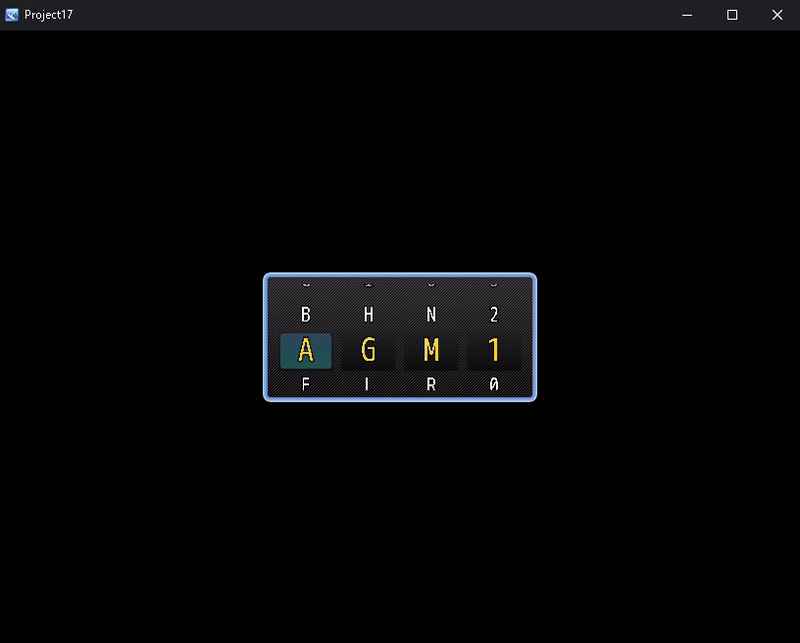

# KP_InputAlphabet.js
RPGツクールMZ向けの「ダイヤル式アルファベット入力」プラグインです。

# [ダウンロード](./KopiLuwak668/RPGMZ/blob/main/KP_InputAlphabetMZ.js) 

# 【概要】
  横並びのダイヤルを回すようにアルファベットや数字を入力します。
  複数のパズルを個別の「識別名」で管理でき、連続したパスワード入力にも対応しています。

# 【使い方】
  1. プラグイン設定の「パズル全データの登録」にパズルを追加します。
  2. 「パズル識別名」に好きな名前（例：DoorA）を付けます。
  3. 「各桁の候補文字」に、その桁で選べる文字（例：ABC, 12345）を登録します。
  ※「各桁の候補文字」は、カンマなどで区切らず直接入力してください。 
  4. イベントの「プラグインコマンド」から「開始」を選び、識別名と
  結果を格納する変数番号を指定して実行します。
 
# 【仕様と注意点】
  ■桁数の決まり方
  「各桁の候補文字」を登録した「項目数」がそのまま桁数になります。
  10個登録すれば10桁、3個登録すれば3桁の入力ウィンドウが自動で作成されます。
 
# 【判定のコツ】
  - 入力終了後、指定した変数に結果が文字列として保存されます。
  「条件分岐」のスクリプトで以下のように判定してください：
    $gameVariables.value(1) === "ABC"
    
  - ※大文字・小文字を区別しない場合は以下の通り
    $gameVariables.value(1).toLowerCase() === "abc" 

# 【動作デモ】
 
 
# 【利用規約】
  MITライセンスに基づき、営利・非営利を問わず自由にご利用いただけます。  
  クレジット表記もこのヘッダーが残っていれば、ゲーム内への記載は任意です。
 
# 【更新履歴】
  26.01.25　v1.00　公開
 
# ライセンス
  MIT License
